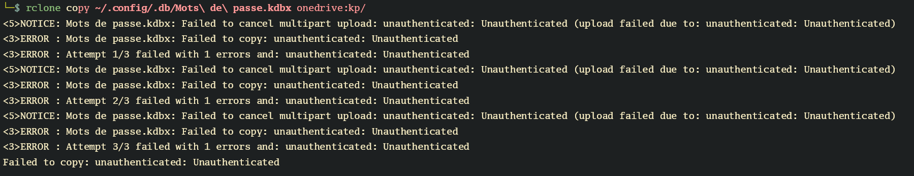
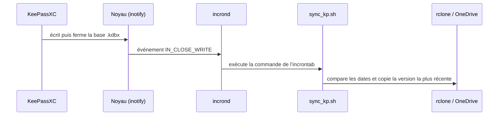

# 🔐 Synchroniser automatiquement KeePassXC avec le cloud

## 🌟 Objectif

Ce guide vous explique **pas à pas** comment configurer votre ordinateur Linux pour **synchroniser automatiquement** votre base de données KeePassXC avec le cloud (dans mon cas **OneDrive**) à l’aide d’un script Bash, d’un service `systemd` et de **incron**.

Cela vous permettra d’utiliser KeePassXC sur votre PC **et** sur votre téléphone via l'application mobile comme _KeePass2Android_ 📱, en gardant **tout synchronisé automatiquement** ✅

- **systemd** lance une première synchronisation à l’ouverture de session.
- **incron** relance cette synchronisation **dès que la base est sauvegardée** par KeePassXC.

---

## 🧰 Ce dont vous avez besoin

### 🟢 Logiciels à installer

| Logiciel                     | Description                                      | Installation                                                                  |
| ---------------------------- | ------------------------------------------------ | ----------------------------------------------------------------------------- |
| 🧠 **KeePassXC**             | Le gestionnaire de mots de passe libre           | via le gestionnaire de paquets ou [keepassxc.org](https://keepassxc.org)      |
| ☁️ **rclone**                | Pour accéder à OneDrive depuis Linux             | via le gestionnaire de paquets ou [rclone.org](https://rclone.org/downloads/) |
| 👁️ **incron**                | Pour réagir aux modifications de la base         | Paquet : `incron` (Debian/Ubuntu)                                             |
| 🔔 `notify-send` (optionnel) | Pour recevoir des notifications sur votre bureau | Paquet : `libnotify-bin` (Debian/Ubuntu)                                      |

```bash
sudo apt update
# Installer KeePassXC (gestionnaire de mots de passe)
sudo apt install -y keepassxc

# Installer incron (synchronisation à chaque sauvegarde)
sudo apt install -y incron

# Installer notify-send pour les notifications (optionnel mais recommandé)
sudo apt install -y libnotify-bin
```

_**Installer rclone (accès à OneDrive)**_

Installer rclone depuis le site officiel : [rclone.org/downloads/](https://rclone.org/downloads/) pour avoir la dernière version. Je l'ai d'abord installé depuis les dépôts de ma distribution Linux et j'ai rencontré un problème avec la copie de la base de données gérée par KeePassXC.



### 📁 Fichiers utilisés

```text
/home/<utilisateur>/.local/bin/sync_kp.sh                    ← Script Bash de synchronisation
/home/<utilisateur>/.config/systemd/user/sync-kp.service     ← Synchronisation à l’ouverture de session
incrontab de l’utilisateur                                   ← Synchronisation à chaque sauvegarde
```

### ⚙️ Vue d’ensemble



---

## ☁️🔧 Étape 1 – Configurer rclone avec OneDrive

1. Ouvrez un terminal.
2. Tapez :

```bash
   rclone config
   n/s/q> n                   👈 Tapez `n` pour créer un nouveau remote
   name> onedrive             👈 Donnez-lui le nom "onedrive"

   Storage> 30                👈 Choisissez "30" pour Microsoft OneDrive

   client_id> [Entrée]        👈 Laissez vide et appuyez sur Entrée
   client_secret> [Entrée]    👈 Laissez vide et appuyez sur Entrée

   region> 1                  👈 Choisissez "1" pour Microsoft Global

   Edit advanced config? n    👈 Tapez `n` (non)

   Use auto config? y         👈 Tapez `y` (oui) — ouvrira une fenêtre dans votre navigateur
                              🔓 Connectez-vous à votre compte Microsoft

   config_type> 1             👈 Choisissez "1" : OneDrive Personnel ou Business

   config_driveid> 5          👈 Choisissez "5" : votre stockage OneDrive personnel

   Drive OK? y                👈 Tapez `y` (oui)

   Keep this "onedrive"? y    👈 Tapez `y` (oui)

   e/n/d/r/c/s/q> q           👈 Tapez `q` pour quitter
```

3. Suivez les étapes pour :

   - Créer une nouvelle **remote**
   - Choisir le type : `OneDrive`
   - Suivre l’authentification
   - Donnez-lui un nom, par exemple : `onedrive`

👉 **Notez bien ce nom**, car vous devrez l’utiliser dans le script.

---

## 📄 Étape 2 – Créer le script de synchronisation

1. Créez le dossier s’il n’existe pas :

   ```bash
   mkdir -p ~/.local/bin
   ```

2. Copiez le script ci-dessous dans le fichier `~/.local/bin/sync_kp.sh` :

   > 💡 **N’oubliez pas d’adapter** les variables `DRIVE_NAME`, `DB_FILE_NAME`, `REMOTE_LOCATION` si besoin.

```bash
   #!/bin/bash

# Name of your remote storage as defined in Rclone
DRIVE_NAME="onedrive"

# Name and locations of the passwords file
DB_FILE_NAME="Mots_de_passe.kdbx"   # prioritize a name without spaces (optional but recommended)
LOCAL_LOCATION="$HOME/.config/.db"
REMOTE_LOCATION="kp"

#####################

# Compose full path to local and remote database files
LOCAL_PATH="$LOCAL_LOCATION/$DB_FILE_NAME"
REMOTE_PATH="$REMOTE_LOCATION/$DB_FILE_NAME"

# Create local directory if it doesn't exist
mkdir -p "$LOCAL_LOCATION"

function format_datetime_from_string () {
    date -d "$1" +"%F %T.%3N"
}

# Parse local passwords file modification time
function get_local_passwords_mtime () {
    if [ -f "$LOCAL_PATH" ]; then
        local string=$(stat -c %y "$LOCAL_PATH" | cut -d ' ' -f 1,2)
        format_datetime_from_string "$string"
    else
        echo "1970-01-01 00:00:00.000"  # Date très ancienne si fichier n'existe pas
        return 1
    fi
}

# Parse remote passwords file modification time
function get_remote_passwords_mtime () {
    output=$(rclone lsl "$DRIVE_NAME:$REMOTE_PATH" 2>/dev/null)
    if [ $? -ne 0 ]; then
        echo "1970-01-01 00:00:00.000"  # Date très ancienne si fichier n'existe pas
        return 1
    else
        local string=$(echo "$output" | tr -s ' ' | cut -d ' ' -f 3,4)
        format_datetime_from_string "$string"
    fi
}

function sync_passwords () {
    # Get modification times
    local local_mtime=$(get_local_passwords_mtime)
    local remote_mtime=$(get_remote_passwords_mtime)

    # Printing modification times
    printf "Local passwords file modification time:\t\t%s\n" "$local_mtime"
    printf "Remote passwords file modification time:\t%s\n" "$remote_mtime"

    # Convert to seconds for comparison
    local local_sec=$(date -d "$local_mtime" +%s)
    local remote_sec=$(date -d "$remote_mtime" +%s)

    # Handle cases
    if [ ! -f "$LOCAL_PATH" ] && [ "$remote_sec" -gt 0 ]; then
        echo "No local file found, importing from remote..."
        notify-send "No local file found, importing from remote..."
        rclone copy "$DRIVE_NAME:$REMOTE_PATH" "$LOCAL_LOCATION/"
        echo "Done!"
        notify-send "Done!"
    elif [ "$remote_sec" -eq 0 ]; then
        echo "No remote file found, exporting local file..."
        notify-send "No remote file found, exporting local file..."
        rclone copy "$LOCAL_PATH" "$DRIVE_NAME:$REMOTE_LOCATION/"
        echo "Done!"
        notify-send "Done!"
    elif [ "$local_sec" -gt "$remote_sec" ]; then
        echo "Local file is newer than remote, exporting..."
        notify-send "Local file is newer than remote, exporting..."
        rclone copy "$LOCAL_PATH" "$DRIVE_NAME:$REMOTE_LOCATION/"
        echo "Done!"
        notify-send "Done!"
    elif [ "$local_sec" -lt "$remote_sec" ]; then
        echo "Remote file is newer than local, importing..."
        notify-send "Remote file is newer than local, importing..."
        rclone copy "$DRIVE_NAME:$REMOTE_PATH" "$LOCAL_LOCATION/"
        echo "Done!"
        notify-send "Done!"
    else
        echo "Password files are synchronized."
        notify-send "Password files are synchronized."
    fi
}

sync_passwords

```

3. Rendez le script exécutable :

   ```bash
   chmod +x ~/.local/bin/sync_kp.sh
   ```

---

## 🚀 Étape 3 – Synchroniser à l’ouverture de session (systemd)

On utilise ici un **service systemd utilisateur** : il tourne avec vos droits et votre `$HOME`, ce qui est indispensable puisque le script lit `~/.config` et la configuration rclone.

1. Créez le dossier :

   ```bash
   mkdir -p ~/.config/systemd/user
   ```

2. Créez le fichier `~/.config/systemd/user/sync-kp.service` :

   ```ini
   [Unit]
   Description=Synchronisation automatique de la base de données de KeePassXC avec le cloud
   After=network-online.target

   [Service]
   Type=oneshot
   ExecStart=%h/.local/bin/sync_kp.sh

   [Install]
   WantedBy=default.target
   ```

   > `%h` est remplacé automatiquement par votre dossier personnel.

3. Activez le service :

   ```bash
   systemctl --user daemon-reload
   systemctl --user enable --now sync-kp.service
   ```

4. Vérifiez son état :

   ```bash
   systemctl --user status sync-kp.service
   ```

---

## 👁️ Étape 4 – Synchroniser à chaque sauvegarde (incron)

Le service systemd ne synchronise qu’une fois, à l’ouverture de session. Si vous modifiez la base puis coupez la machine brutalement (ou si vous restez connecté longtemps), les changements ne partent jamais dans le cloud. **incron** corrige cela : il lance la synchronisation **juste après chaque sauvegarde**.

### 🧠 Comment fonctionne incron ?

incron est un « **inotify cron** ». Il combine deux idées :

- **cron** : un planificateur, mais **déclenché par des événements** et non par l’heure.
- **inotify** : le mécanisme du noyau Linux qui prévient les programmes lorsqu’un fichier change.

Concrètement :

1. Le démon **`incrond`** tourne en arrière-plan (lancé par systemd).
2. Chaque utilisateur possède son propre **incrontab**, géré avec `incrontab -e` / `incrontab -l`.
3. `incrond` lit ces tables et demande au noyau de surveiller les chemins indiqués.
4. Quand un événement correspond au masque, `incrond` exécute la commande **avec les droits de l’utilisateur** propriétaire de l’incrontab (pas ceux de root).
5. Surveiller un **dossier** permet de recevoir les événements des **fichiers qu’il contient** (pas de récursion dans les sous-dossiers).

Chaque ligne de l’incrontab suit la syntaxe :

```text
<chemin surveillé>   <masque d’événements>   <commande>
```

Les masques les plus utiles :

| Événement        | Déclenché quand…                                                |
| ---------------- | --------------------------------------------------------------- |
| `IN_CLOSE_WRITE` | un fichier ouvert en écriture est refermé (sauvegarde terminée) |
| `IN_MOVED_TO`    | un fichier est déplacé ou renommé **dans** le dossier surveillé |
| `IN_CREATE`      | un fichier est créé                                             |
| `IN_DELETE`      | un fichier est supprimé                                         |
| `IN_MODIFY`      | le contenu d’un fichier est modifié                             |
| `IN_ATTRIB`      | les métadonnées changent (droits, date de modification…)        |

On peut combiner plusieurs masques avec des virgules (`IN_CLOSE_WRITE,IN_MOVED_TO`) et utiliser les variables `$#` (nom du fichier) et `$%` (événement) dans la commande.

### 📥 Installer et activer incron

```bash
sudo apt install -y incron
sudo systemctl enable --now incrond
systemctl status incrond
```

### ✍️ Ajouter la règle

```bash
incrontab -e
```

Nano s’ouvre (sinon, forcez-le avec `EDITOR=nano incrontab -e`). Ajoutez l’entrée suivante, en remplaçant `<user_name>` par votre nom d’utilisateur :

```text
/home/<user_name>/.config/.db   IN_CLOSE_WRITE   /home/<user_name>/.local/bin/sync_kp.sh
```

Enregistrez avec `Ctrl+X`, puis `Y` et `Entrée`.

Vérifiez que la règle est bien prise en compte :

```bash
incrontab -l
```

> 🩹 Si `incrontab -e` répond _« user … is not allowed »_, autorisez votre utilisateur :
>
> ```bash
> echo "$USER" | sudo tee -a /etc/incron.allow
> ```

> 💡 Si KeePassXC utilise la sauvegarde atomique (fichier temporaire puis renommage), ajoutez `IN_MOVED_TO` au masque : `IN_CLOSE_WRITE,IN_MOVED_TO`. Sans cela, la synchronisation peut se lancer avant que le fichier final n’ait remplacé l’ancien.

### 🔍 Suivre les événements

```bash
journalctl -u incrond -f
```

---

## 🧪 Étape 5 – Premier test

1. Lancez le script manuellement pour vérifier rclone :

   ```bash
   ~/.local/bin/sync_kp.sh
   ```

   👉 Vous verrez des messages s’afficher dans le terminal (et des notifications si `notify-send` est installé).

2. Vérifiez que la base est bien copiée dans le cloud ou depuis le cloud.

3. Testez incron sans toucher à la base :

   ```bash
   echo test > ~/.config/.db/test_incron
   rm ~/.config/.db/test_incron
   ```

   👉 La création du fichier déclenche `IN_CLOSE_WRITE`, donc le script doit s’exécuter (visible dans `journalctl -u incrond -f`).

4. Enfin, ouvrez KeePassXC, modifiez une entrée et enregistrez : la synchronisation doit partir immédiatement.

---

## 📱 Utiliser sur votre téléphone

1. Installez [KeePass2Android](https://play.google.com/store/apps/details?id=keepass2android.keepass2android).
2. Connectez-vous à votre compte OneDrive.
3. Sélectionnez le fichier `.kdbx` synchronisé.
4. C’est prêt ✅

---

## ❗ Remarques et limites

- Le script est conçu pour :

  - Synchroniser à l’ouverture de session (télécharger si besoin)
  - Synchroniser dès qu’une sauvegarde est détectée par incron (envoyer si modifié)

- **incron ne remplace pas le service d’ouverture de session** : il ne se déclenche que sur un événement. Les deux sont complémentaires.

- Les **notifications** (`notify-send`) peuvent ne pas s’afficher lorsqu’elles sont lancées par incron, car `incrond` n’a pas accès à la session D-Bus du bureau. Le script et rclone fonctionnent quand même.

- Le service `systemd` utilisateur démarre à la connexion. Pour qu’il tourne même sans session ouverte (par exemple sur un serveur), activez le _linger_ :

  ```bash
  sudo loginctl enable-linger "$USER"
  ```

---

## 🧽 Désinstallation (facultatif)

```bash
# Service systemd utilisateur
systemctl --user disable --now sync-kp.service
rm ~/.config/systemd/user/sync-kp.service

# Règles incron (supprime toute l’incrontab de l’utilisateur)
incrontab -r

# Paquet incron (optionnel)
sudo systemctl disable --now incrond
sudo apt remove -y incron

# Script
rm ~/.local/bin/sync_kp.sh
```

---

## 🙏 Crédits

📝 Script original :
[Z. Baratz – KeePassXC avec synchronisation cloud](https://medium.com/@z.baratz/setting-up-keepassxc-on-linux-with-cloud-synchronization-85ccce837365)

✨ Adaptation, documentation, système et incron : \[Betzalel75]

---

## ✅ Résultat

Vous disposez maintenant d’un gestionnaire de mots de passe **sécurisé, libre, multi-plateforme** et **synchronisé automatiquement** entre vos appareils. Félicitations 🎉 !
